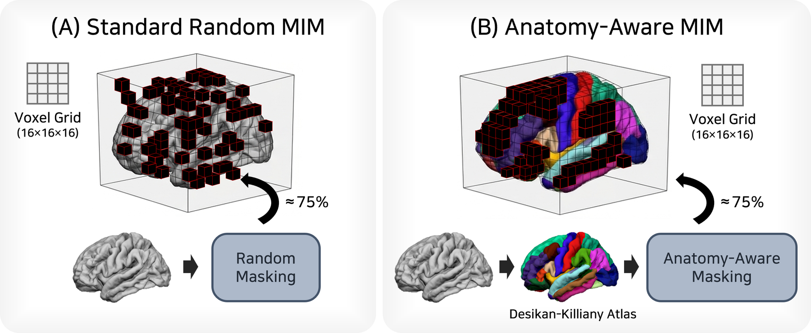

<div align="center">

# Anatomy-Aware MIM

**Anatomy-Aware Masked Image Modeling for Self-Supervised Learning on 3D Brain MRI**

[Yeonwoo Kim](https://github.com/dusdnKR), Won Hee Lee<br>
Kyung Hee University

*CCN 2026*

[](https://openreview.net/forum?id=pWyo5leiDF)&nbsp;
[](https://pytorch.org/)&nbsp;
[](https://www.python.org/)&nbsp;
[](LICENSE)


<br>
<em>(A) Standard Random MIM &nbsp;·&nbsp; (B) Anatomy-Aware MIM</em>

</div>

---

## Overview

Masked image modeling (MIM) pretrains a vision encoder by reconstructing randomly masked patches, but uniform random masking gives every patch — a sliver of cortex, a strip of white matter — the same chance of being hidden, regardless of anatomy. The encoder can then fill most gaps by interpolating from neighboring voxels.

**Anatomy-aware MIM** masks by cortical parcellation instead: whole Desikan–Killiany regions are hidden together, so the encoder has to recover them from long-range inter-regional context rather than local interpolation.

## Paper

> **Y. Kim** and W. H. Lee, "Anatomy-Aware Masked Image Modeling for Self-Supervised Learning on 3D Brain MRI," in *9th Annual Conference on Cognitive Computational Neuroscience (CCN 2026)*, 2026.

Read the paper on [OpenReview](https://openreview.net/forum?id=pWyo5leiDF), or download the [camera-ready PDF](paper/Anatomy-Aware-MIM_CCN2026_cameraReady.pdf).

## Method

A 3D Swin Transformer encoder is pretrained on T1-weighted brain MRI with seven pretext tasks trained jointly, then evaluated frozen with linear probing. The masking strategy is the only difference between the baseline and the proposed model, selected by one flag.

| Component | Role |
|:---:|---|
| **Masking** | `MaskGenerator` hides random patches (`--mim-mask-mode random`); `AtlasGuidedMaskGenerator` hides whole atlas regions (`--mim-mask-mode atlas`) |
| **Encoder** | 3D Swin Transformer (MONAI SwinUNETR backbone), shared by every head |
| **Pretext tasks** | masked-image reconstruction, rotation, patch location, contrastive (NT-Xent), anatomy segmentation, morphology regression, texture regression |
| **Loss weighting** | learned uncertainty weighting across the seven tasks |
| **Evaluation** | frozen-encoder linear probing with k-fold cross-validation |

## Repository layout

```
anatomy-aware-mim/
├── main.py              # multi-task pre-training entry point; both mask generators
├── models.py            # SSLHead_Swin — shared encoder + one head per pretext task
├── swin_unetr.py        # 3D Swin Transformer backbone (MONAI)
├── datasets.py          # subject discovery and pretext-target loading
├── loss.py              # NT-Xent contrastive loss + uncertainty weighting
├── ops.py               # random 90° rotation augmentation (image and atlas co-rotated)
├── utils.py             # distributed setup, schedulers, checkpointing, logging
├── linear_probe.py      # frozen-encoder linear probing with k-fold cross-validation
├── extract/             # one-off extraction of the tabular pretext targets
├── scripts/             # pre-training and linear-probing launchers
├── paper/               # camera-ready PDF
└── assets/              # README figure
```

## Getting started

### Installation

```bash
conda create -n aamim python=3.10 -y
conda activate aamim
pip install -r requirements.txt
```

### Data

Each subject is a directory holding a brain-extracted T1-weighted volume and its cortical parcellation, as produced by a FreeSurfer-style pipeline (e.g. FastSurfer):

```
<data-path>/
  <subject>/
    mri/brainmask.nii.gz            brain-extracted T1w
    mri/aparc+aseg.nii.gz           cortical parcellation
    mri/aparc+aseg.mgz              (input to extract/gmwmcsf.py)
    stats/lh.aparc.DKTatlas.mapped.stats
    stats/rh.aparc.DKTatlas.mapped.stats
  results/                          written by extract/ (see below)
```

Passing `--data <name>` restricts training to the subject directories listed in `data/<name>.txt` (or `<data-path>/<name>.txt`), one subject per line.

### Pre-computing pretext targets

The morphology and texture tasks regress per-subject descriptors that are too slow to derive on the fly, so they are extracted once into `<data-path>/results/`:

```bash
python extract/gmwmcsf.py --data-path /path/to/dataset
python extract/extract_all_features.py --data-path /path/to/dataset --workers 32
```

### Pre-training

The two conditions differ in exactly one flag:

```bash
# baseline: random masking
python -m torch.distributed.launch --nproc_per_node=4 main.py \
    --data-path /path/to/dataset \
    --mim-mask-mode random \
    --epochs 300 --batch_size_per_gpu 2 \
    --output_dir ./runs/random_mim --name random_mim

# ours: anatomy-aware masking
python -m torch.distributed.launch --nproc_per_node=4 main.py \
    --data-path /path/to/dataset \
    --mim-mask-mode atlas \
    --epochs 300 --batch_size_per_gpu 2 \
    --output_dir ./runs/atlas_mim --name atlas_mim
```

Optimization uses AdamW with a base learning rate of `5e-4` scaled linearly by the effective batch size, cosine annealing, 5 warm-up epochs, and mixed precision. Checkpoints are written to `--output_dir` every `--saveckp_freq` epochs, and metrics are streamed to Weights & Biases (`--project`, `--name`; `--run-id` resumes an existing run).

Ready-made wrappers for both runs are in [`scripts/`](scripts).

### Linear probing

Freeze a checkpoint and evaluate it:

```bash
python linear_probe.py \
    --checkpoint ./runs/atlas_mim/checkpoint0100.pth \
    --data-path /path/to/eval_dataset \
    --gpu 0
```

The evaluation root needs a `participants.tsv` with a `group` column; subjects labelled `HC` or `SCZ` are kept, everything else is dropped. Metrics (balanced accuracy, AUC, F1, precision, recall) are pooled over the held-out folds and written to `--output-dir` as JSON.

## Related work

| | |
|---|---|
| **Upstream code** | J. Kim, M. Kim, and H. Park, "Domain Aware Multi-Task Pre-Training of 3D Swin Transformer for Brain MRI," *ACCV 2024*, pp. 2124–2144. ([arXiv](https://arxiv.org/abs/2410.00410), [Code](https://github.com/jongdory/DAMT)) — this repository forks DAMT; the training pipeline, model and seven pretext tasks are the original DAMT code, and the only change is `AtlasGuidedMaskGenerator` in `main.py`. |

## Acknowledgment

This work was supported in part by the Institute of Information & Communications Technology Planning & Evaluation (IITP), funded by the Korea government (MSIT), under grants RS-2024-00509257 (Global AI Frontier Lab) and IITP-2026-RS-2024-00438239 (ITRC); in part by the National Research Foundation of Korea (NRF), funded by MSIT (RS-2026-25485605); and in part by the Korea Health Technology R&D Project through the Korea Health Industry Development Institute (KHIDI), funded by the Ministry of Health and Welfare (RS-2025-02293110).

The Swin Transformer backbone in `swin_unetr.py` is adapted from [MONAI](https://github.com/Project-MONAI/MONAI)'s SwinUNETR, and the distributed-training utilities in `utils.py` from [DINO](https://github.com/facebookresearch/dino); both were already vendored in upstream DAMT.

## License

Released under the [Apache License 2.0](LICENSE). DAMT, MONAI and DINO code is also Apache-2.0; their notices are kept in [NOTICE](NOTICE).

## Citation

```bibtex
@inproceedings{kim2026anatomy,
  title     = {Anatomy-Aware Masked Image Modeling for Self-Supervised Learning on {3D} Brain {MRI}},
  author    = {Kim, Yeonwoo and Lee, Won Hee},
  booktitle = {9th Annual Conference on Cognitive Computational Neuroscience (CCN 2026)},
  year      = {2026},
  url       = {https://openreview.net/forum?id=pWyo5leiDF}
}
```
